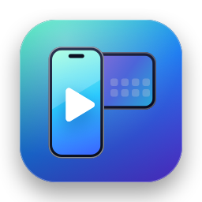
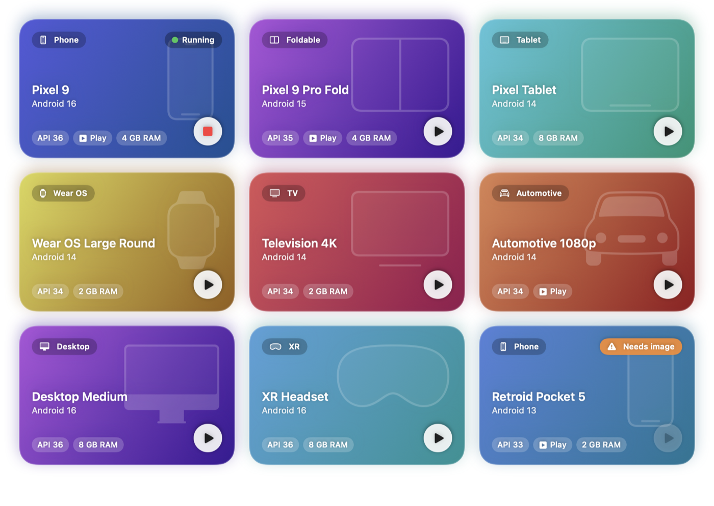
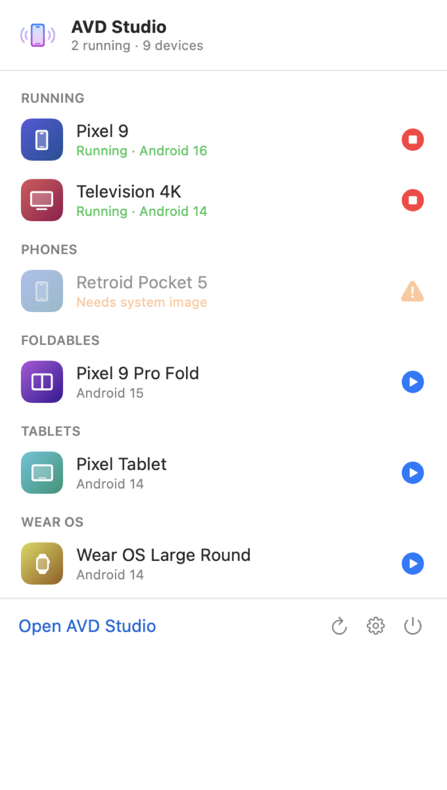
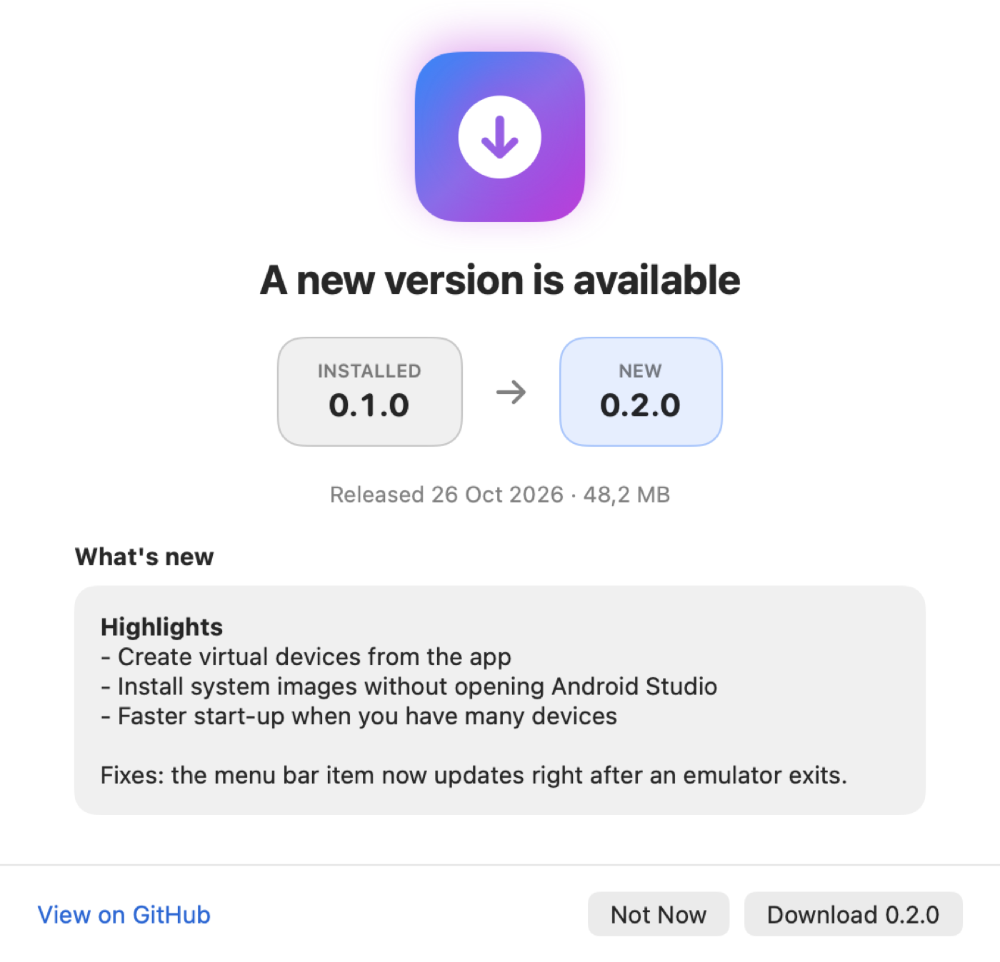

<p align="center">
  
</p>

<h1 align="center">AVD Studio</h1>

<p align="center">
  A native macOS app and command-line tool for Android Virtual Devices.<br>
  Browse your emulators as a colourful grid, start them from the menu bar, keep using your own Android SDK.
</p>

<p align="center">
  <a href="https://github.com/mrcsxsiq/avd-studio/actions/workflows/ci.yml"></a>
  <a href="LICENSE"></a>
  
</p>

<p align="center">
  <picture>
    <source media="(prefers-color-scheme: dark)" srcset="docs/images/app-dark.png">
    
  </picture>
</p>

> **Status:** early development. The app, the CLI and the tests work; the first release (DMG + Homebrew) is not published yet.
> Website: https://avdstudio.dev (goes live with the first release; until then https://mrcsxsiq.github.io/avd-studio/).

## What it does

- **See every emulator at a glance.** Each virtual device is a card with its own gradient, grouped in the sidebar by type: phone, foldable, tablet, Wear OS, TV, automotive, desktop and XR. Search by name, Android version or device profile.
- **Start and stop with one click or a double-click.** Per-device actions: start, stop, cold boot, wipe data and start (with confirmation), show in Finder, copy name. Emulators started from Android Studio or a terminal show up as running too.
- **Menu bar.** Start, test and stop emulators without opening the window. Pick the icon from ten options (a phone, a tablet, a watch, a little droid…); a dot shows when something is running.
- **Set up Android in one click.** No SDK? AVD Studio installs Google's command-line tools, a Java runtime, the emulator and the system images your devices need (through Homebrew and `sdkmanager`). Without Homebrew it gives you a script for Terminal. Already have an SDK? Point to it.
- **Your folders, your rules.** Choose the SDK folder and the virtual-device folder (for example on an external SSD). Nothing is moved and Android Studio's settings are untouched.
- **Light, dark or system theme.**
- **Updates built in.** Shows the installed version next to the new one with release notes, downloads the DMG and verifies its SHA-256, and notifies you when a version is released. Automatic checks can be turned off.
- **A real CLI.** `avdstudio list`, `start`, `doctor`, `setup` and `sdk-path`, with `--json` for scripts.
- **No analytics, no accounts.** The only network traffic is the optional update check against the GitHub Releases API.

<p align="center">
  <picture>
    <source media="(prefers-color-scheme: dark)" srcset="docs/images/menu-bar-dark.png">
    
  </picture>
  &nbsp;&nbsp;
  <picture>
    <source media="(prefers-color-scheme: dark)" srcset="docs/images/update-dark.png">
    
  </picture>
</p>

## Requirements

- An Apple Silicon Mac running macOS 14 (Sonoma) or newer.
- The Android command-line tools, emulator and `adb` (AVD Studio can install them for you; see [First run](#first-run)).
- A Java runtime for `sdkmanager`/`avdmanager` (also installed for you if missing).

AVD Studio never bundles the Android SDK. It runs the tools that are on your Mac, under Google's own licence.

## Install

Available with the first release:

| Way | Command |
| --- | --- |
| DMG | Download `AVD-Studio-<version>.dmg` from [Releases](https://github.com/mrcsxsiq/avd-studio/releases), open it and drag the app to Applications. |
| Homebrew (app) | `brew tap mrcsxsiq/avd-studio https://github.com/mrcsxsiq/avd-studio && brew install --cask avd-studio` |
| Homebrew (CLI) | `brew install avdstudio` (after the same `brew tap`) |

Until the first release, [build from source](#build-from-source).

## First run

AVD Studio looks for an SDK in `ANDROID_SDK_ROOT`, `ANDROID_HOME`, Android Studio's default folder
(`~/Library/Android/sdk`) and Homebrew's `android-commandlinetools`, in that order. Virtual devices are read from
`~/.android/avd` (or `ANDROID_AVD_HOME`).

If nothing usable is found you get a setup screen with two routes:

- **Install Automatically…** lists exactly what will run (`brew install --cask android-commandlinetools`,
  `brew install openjdk@17`, `sdkmanager …`), asks you to accept the Android SDK License Agreement, then does it
  all and switches to the new SDK. Without Homebrew the same steps become a script you can open in Terminal.
- **I Already Have an SDK…** lets you choose the folder.

Settings → Diagnostics shows the same checks later, with a **Fix Automatically…** button when something is missing.

## Command line

```text
avdstudio list [--json]                      List the virtual devices
avdstudio start <name> [--cold-boot] [--wipe-data] [--print-command]
avdstudio doctor [--json]                    Check the SDK, Java and devices; prints numbered next steps
avdstudio setup [--dry-run] [--script] [--accept-licenses]
                                             Install what is missing (Homebrew + sdkmanager)
avdstudio sdk-path                           Print the SDK folder in use
```

`--sdk-path` and `--avd-home` (or `AVDSTUDIO_SDK_PATH` / `AVDSTUDIO_AVD_HOME`) override auto-detection on every
command. Colours are only used on a terminal; `--json` output is stable for scripting. Exit status is 0 on success,
1 when something is wrong (`doctor` treats a missing `adb` as a warning, not a failure).

```console
$ avdstudio doctor
✓ Android SDK  /Users/you/Library/Android/sdk (Android Studio default)
✓ sdkmanager  /Users/you/Library/Android/sdk/cmdline-tools/latest/bin/sdkmanager
✓ avdmanager  /Users/you/Library/Android/sdk/cmdline-tools/latest/bin/avdmanager
✗ emulator  Not found (expected at /Users/you/Library/Android/sdk/emulator/emulator).
✓ adb  /Users/you/Library/Android/sdk/platform-tools/adb
✓ Java runtime  /opt/homebrew/opt/openjdk@17/libexec/openjdk.jdk/Contents/Home
✓ Virtual device folder  /Users/you/.android/avd — 3 device(s)

Next steps
  1. Install the missing SDK packages with `sdkmanager --sdk_root=/Users/you/Library/Android/sdk "emulator"`.

Then run `avdstudio doctor` again to check.
```

## Settings

| Section | What you can change |
| --- | --- |
| Appearance | System, Light or Dark |
| Android SDK | The SDK folder (leave empty for auto-detection) |
| Virtual devices | The folder that holds the `.avd` files |
| Updates | Automatic checks on/off, Check for Updates… |
| Menu bar | Show the menu bar item; choose one of ten icons |
| Diagnostics | The same checks as `avdstudio doctor`, with Fix Automatically… |

## How it works

```text
core/    Kotlin Multiplatform (Kotlin/Native, macosArm64)   SDK/Java detection, AVD reader, emulator control,
                                                            doctor, setup planner. No UI, no Java at runtime.
cli/     Kotlin/Native executable (Clikt)                    `avdstudio`, built on core.
macos/   Swift package + XcodeGen project                    AVDStudioUI (SwiftUI, no Kotlin), AVDStudioKit (the
                                                            only module that imports the Kotlin framework), App/.
website/ Static landing page                                 Deployed to GitHub Pages.
```

The core is compiled to an XCFramework and consumed by the app as a static framework. Everything the UI needs goes
through one Swift protocol (`DeviceService`), so views and view models are tested with fakes and the Kotlin bridge is
tested against the real core in a temporary home folder. See [docs/ARCHITECTURE.md](docs/ARCHITECTURE.md).

Virtual devices are read straight from the `.ini`/`config.ini` files, not through `avdmanager`: it is instant, needs
no Java, and also shows devices whose system image is missing (with a way to fix it).

## Build from source

You need Xcode 16 or newer (Swift 6), a JDK 17 or newer and [XcodeGen](https://github.com/yonaskolb/XcodeGen).
`make bootstrap` installs the last two with Homebrew.

```bash
git clone https://github.com/mrcsxsiq/avd-studio.git
cd avd-studio
make bootstrap      # xcodegen + openjdk@17 (Brewfile)
make core           # Kotlin core -> macos/Frameworks/AVDStudioCore.xcframework
make app            # Release build of the app (build/xcode/Build/Products/Release/AVD Studio.app)
make install        # …and copy it to /Applications
make cli            # cli/build/bin/macosArm64/releaseExecutable/avdstudio.kexe
make test           # Kotlin + Swift tests, including screenshot tests
```

`make help` lists every target. Open `macos/AVDStudio.xcodeproj` (generated by `make generate`) to work in Xcode.

## Contributing

Bug reports, ideas and pull requests are welcome. Read [CONTRIBUTING.md](CONTRIBUTING.md) for the setup, the
test rules and the review checklist, and [CODE_OF_CONDUCT.md](CODE_OF_CONDUCT.md) for how we treat each other.
Working with an AI agent? [AGENTS.md](AGENTS.md) has the instructions it needs.

Releases follow [Semantic Versioning](https://semver.org); every user-visible change is listed in
[CHANGELOG.md](CHANGELOG.md).

## License

[MIT](LICENSE) © Marcos Paulo Farias. Third-party components are listed in [LICENSES.md](LICENSES.md).

Android is a trademark of Google LLC. Apple, macOS, Swift and SwiftUI are trademarks of Apple Inc. AVD Studio is an
independent project, not affiliated with or endorsed by Google or Apple.
