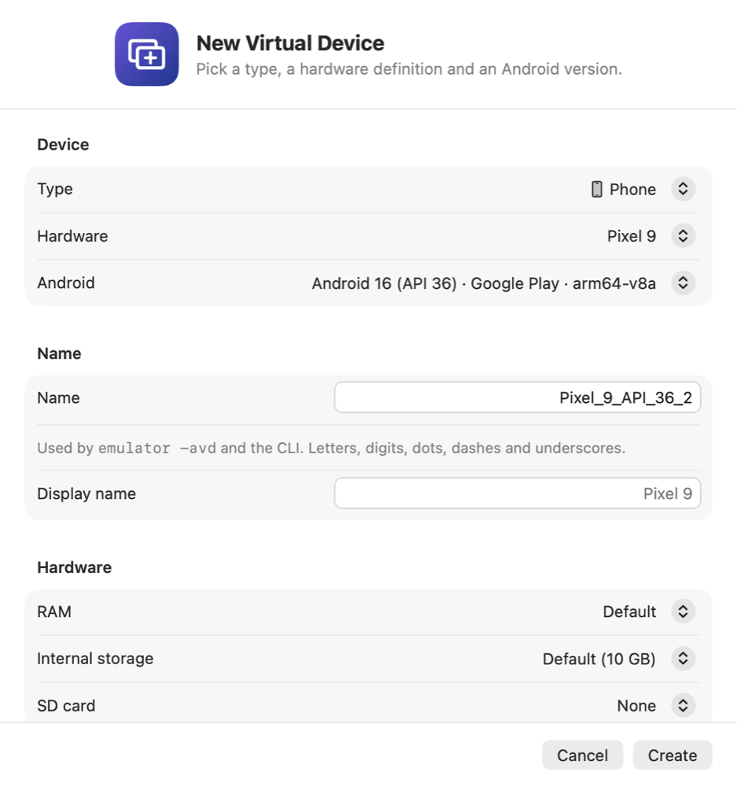
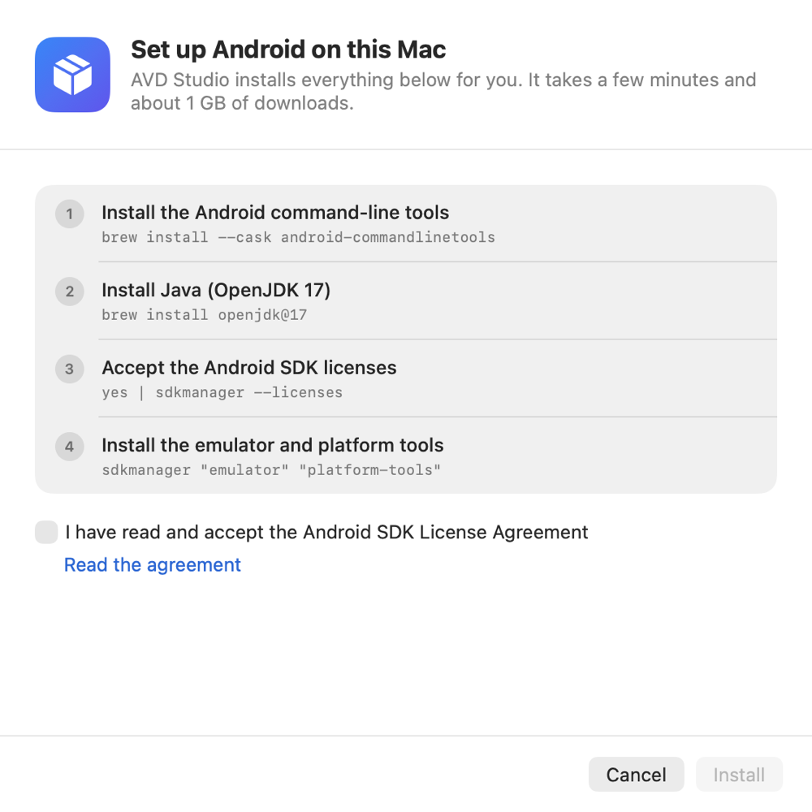

<p align="center">
  
</p>

<h1 align="center">AVD Studio</h1>

<p align="center">
  A native macOS app and command-line tool for Android Virtual Devices.<br>
  Browse your emulators as a colourful grid, start them from the menu bar, keep using your own Android SDK.
</p>

<p align="center">
  <a href="https://github.com/mrcsxsiq/avd-studio/actions/workflows/ci.yml"></a>
  <a href="https://github.com/mrcsxsiq/avd-studio/releases/latest"></a>
  <a href="LICENSE"></a>
  
  
</p>

<p align="center">
  
  
  
  
  
  
  
  
</p>

<p align="center">
  <picture>
    <source media="(prefers-color-scheme: dark)" srcset="docs/images/app-dark.png">
    
  </picture>
</p>

## Highlights

- **See every emulator at a glance.** Gradient cards grouped by type: phone, foldable, tablet, Wear OS, TV,
  automotive, desktop and XR. Search by name, Android version or device profile.
- **Create, start, stop, delete.** A New Device sheet (⌘N), cold boot, wipe data, show in Finder. Emulators started
  from Android Studio or a terminal show up as running too.
- **Menu bar.** Every device with a play or stop button, plus New Device…, so you never open the window. Ten icons
  to choose from.
- **Set up Android in one click.** No SDK? AVD Studio installs the command-line tools, a Java runtime, the emulator
  and the system images your devices need. Already have an SDK? Point to it.
- **Manage system images.** Download more Android versions, see how much room each takes, remove the ones you
  don't need.
- **Updates built in.** Press **Install** and the app updates itself, through Homebrew or from a verified GitHub DMG.
- **A real CLI.** `avdstudio` does the same from a terminal, with `--json` for scripts.
- **No analytics, no accounts.** The only network traffic of its own is the optional update check.

More in the [user guide](docs/USER-GUIDE.md).

<p align="center">
  <picture>
    <source media="(prefers-color-scheme: dark)" srcset="docs/images/menu-bar-dark.png">
    
  </picture>
  &nbsp;&nbsp;
  <picture>
    <source media="(prefers-color-scheme: dark)" srcset="docs/images/update-dark.png">
    
  </picture>
</p>

<p align="center">
  <picture>
    <source media="(prefers-color-scheme: dark)" srcset="docs/images/create-dark.png">
    
  </picture>
  &nbsp;&nbsp;
  <picture>
    <source media="(prefers-color-scheme: dark)" srcset="docs/images/setup-dark.png">
    
  </picture>
</p>

## Install

You need an Apple Silicon Mac running macOS 14 (Sonoma) or newer.

**Homebrew** (this repository is its own tap; the one cask installs the app and the `avdstudio` command):

```bash
brew tap mrcsxsiq/avd-studio https://github.com/mrcsxsiq/avd-studio
brew install --cask mrcsxsiq/avd-studio/avd-studio
```

**DMG:** download `AVD-Studio-<version>.dmg` from [Releases](https://github.com/mrcsxsiq/avd-studio/releases), open
it and drag the app to Applications.

Releases are not notarized yet. The Homebrew cask clears the quarantine flag for you; with the DMG, right-click the
app and choose **Open** the first time. Trusting the tap, updating and uninstalling are covered in
[Installing and updating](docs/INSTALL.md).

AVD Studio never bundles the Android SDK: it runs the tools that are on your Mac, under Google's own licence, and
can install them for you on first launch (see [First run](docs/USER-GUIDE.md#first-run)).

## Command line

```bash
avdstudio list                      # your virtual devices
avdstudio start my-phone            # start one (--cold-boot, --wipe-data)
avdstudio doctor                    # check the SDK, Java and devices, with numbered next steps
avdstudio images --available        # system images you can download
avdstudio setup --dry-run           # what would be installed, without installing it
```

Add `--json` for scripts. Every command, option and an end-to-end example are in the
[command line reference](docs/CLI.md).

## Built with

| Layer | Technology | Where |
| --- | --- | --- |
| Logic | Kotlin Multiplatform on Kotlin/Native (`macosArm64`) with Okio. No JVM at runtime. | [`core/`](core) |
| CLI | Kotlin/Native executable with [Clikt](https://github.com/ajalt/clikt) and kotlinx.serialization for `--json` | [`cli/`](cli) |
| App | Swift 6, SwiftUI with `@Observable`, SwiftPM and [XcodeGen](https://github.com/yonaskolb/XcodeGen) | [`macos/`](macos) |
| Tests | `kotlin.test`, Swift Testing, [swift-snapshot-testing](https://github.com/pointfreeco/swift-snapshot-testing) | |
| Website | Static HTML, CSS and JS on GitHub Pages | [`website/`](website) |
| Distribution | DMG on GitHub Releases and a Homebrew cask | [`Casks/`](Casks) |
| Tooling | Gradle, ktlint, `swift format`, GitHub Actions, Dependabot | |

The core is compiled to an XCFramework that the app links as a static framework. The UI never imports Kotlin: it
talks to the core through one Swift protocol, so views are tested with fakes. [Architecture](docs/ARCHITECTURE.md)
has the diagram and the reasoning.

## Build from source

You need Xcode 16 or newer (Swift 6), a JDK 17 or newer and XcodeGen; `make bootstrap` installs the last two.

```bash
git clone https://github.com/mrcsxsiq/avd-studio.git
cd avd-studio
make bootstrap      # xcodegen + openjdk@17
make core           # Kotlin core -> macos/Frameworks/AVDStudioCore.xcframework
make app            # Release build of the app
make test           # Kotlin + Swift tests, including screenshot tests
```

`make help` lists every target, and [CONTRIBUTING.md](CONTRIBUTING.md#setup) covers working in Xcode.

## Documentation

| Read | To learn |
| --- | --- |
| [Installing and updating](docs/INSTALL.md) | Homebrew trust, Gatekeeper, updates, uninstalling |
| [User guide](docs/USER-GUIDE.md) | First run, every feature and the Settings tabs |
| [Command line reference](docs/CLI.md) | All commands and options, exit codes, `doctor` |
| [Architecture](docs/ARCHITECTURE.md) | How the Kotlin core, the CLI and the SwiftUI app fit together |
| [Contributing](CONTRIBUTING.md) | Setup, test rules, pull requests |
| [Releasing](docs/RELEASING.md) | How a release is cut, with the [Gitflow](GITFLOW.md) and [versioning](VERSIONING.md) rules behind it |
| [Changelog](CHANGELOG.md) | What changed in every version |
| [Security](SECURITY.md) | How to report a vulnerability |

## Contributing

Bug reports, ideas and pull requests are welcome. [CONTRIBUTING.md](CONTRIBUTING.md) has the setup, the test rules
and the review checklist, and the [Code of Conduct](CODE_OF_CONDUCT.md) says how we treat each other. Working with an
AI agent? [AGENTS.md](AGENTS.md) has the instructions it needs.

## License

[MIT](LICENSE) © Marcos Paulo Farias. Third-party components are listed in [LICENSES.md](LICENSES.md).

Android is a trademark of Google LLC. Apple, macOS, Swift and SwiftUI are trademarks of Apple Inc. AVD Studio is an
independent project, not affiliated with or endorsed by Google or Apple.
