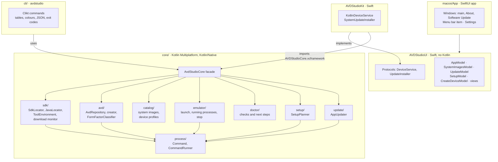
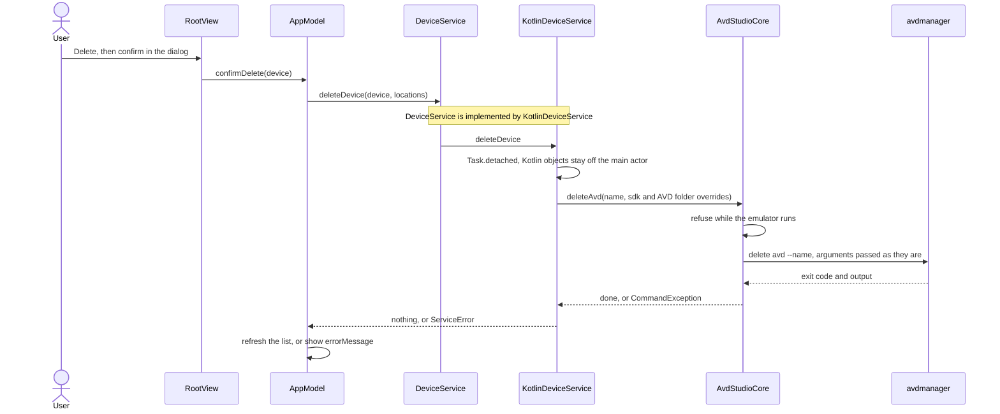
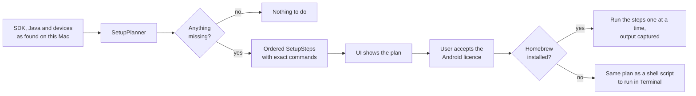
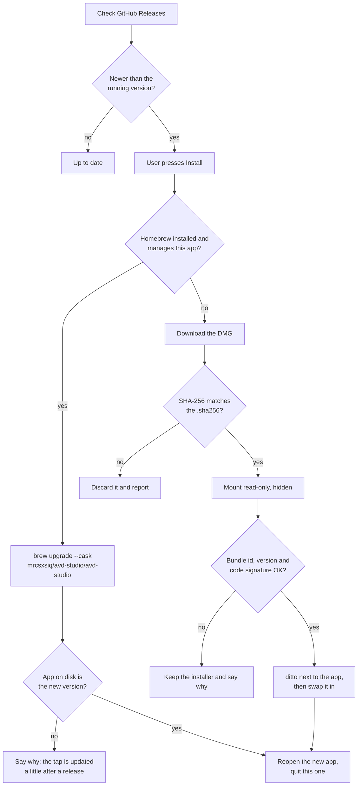
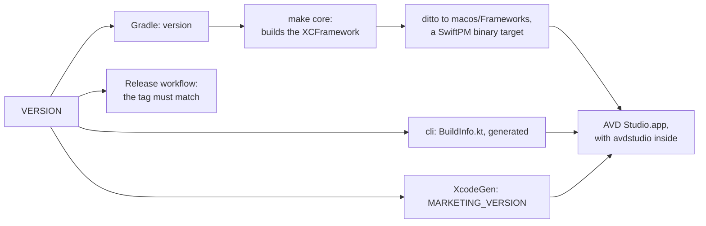

# Architecture

AVD Studio is a native Mac app written in SwiftUI, with all its logic in a Kotlin Multiplatform core that is also
used by the command-line tool. This document explains the pieces, the boundaries between them and why they are
drawn where they are.

*An arrow points from the module that depends on another to the one it depends on. The UI never imports Kotlin: only
`AVDStudioKit` does.*

## Why Kotlin for the core

The core has to do exactly the same thing in the app and in the CLI: find the SDK, read the devices, build the
commands, diagnose problems. Writing it once in Kotlin/Native and compiling it to a static XCFramework keeps the
two front-ends from drifting apart, and the Kotlin test suite (fake file system, recording command runner) covers
the tricky parts without touching a real machine. Kotlin/Native needs no JVM at runtime: the binaries are native
`arm64` Mach-O.

The core is deliberately boring: no coroutines, no reflection, no platform UI. Platform access is confined to two
`expect`/`actual` pairs (file system, environment) and one `NSTask`-backed `CommandRunner`.

## Boundaries

1. **`DeviceService` is the only door between the UI and the world.** `AVDStudioUI` defines the protocol and plain
   Swift value types (`VirtualDevice`, `ToolchainSummary`, `SetupPlan`, …). Views and `@Observable` models are
   written and tested against fakes. `AVDStudioKit` implements the protocol by calling the Kotlin core and mapping
   its types; it is the only module that imports the Kotlin framework.
2. **Kotlin objects never cross into the UI.** They are not `Sendable`, so `KotlinDeviceService` runs each call in
   `Task.detached` and returns value types only.
3. **Overrides flow top-down.** The user's SDK and AVD folder choices live in `AppModel.locations` (persisted in
   `UserDefaults`) and in CLI flags; every core call takes them as optional parameters. The core never stores
   settings.
4. **The CLI is a presentation layer.** It owns argument parsing, tables, colours (TTY only), JSON and exit codes,
   and nothing else.

### One call through the layers

Deleting a device shows all four boundaries at work: the model asks a protocol, the bridge hops off the main actor,
the core decides and runs the command, and only plain values come back.

## Key decisions

- **Devices are read from disk, not from `avdmanager list avd`.** Parsing `<name>.ini` and `<folder>/config.ini`
  is instant, needs no Java, copes with the pointer file and folder having different names, and surfaces devices
  whose system image is missing (which `avdmanager` refuses to list) so the user can fix them.
- **Running emulators come from `ps`.** The `qemu-system-*` process carries `-avd <name>`, so emulators started by
  Android Studio or a terminal are seen too, without `adb`. Stopping looks the pid up again right before signalling.
- **GUI apps get no shell environment.** `ToolEnvironment` builds `PATH`, `JAVA_HOME`, `ANDROID_HOME`,
  `ANDROID_SDK_ROOT` and `ANDROID_AVD_HOME` explicitly for every command; `JavaLocator` finds a JDK itself.
- **Setup is a plan first, then execution.** `SetupPlanner` turns "what is missing" into ordered `SetupStep`s with
  exact commands (Homebrew for tools and Java, `sdkmanager` for packages and images). The UI shows the plan, the
  user accepts the Android licence, and steps run one at a time with their output captured. Without Homebrew the same
  plan is rendered as a shell script.

- **Updates use GitHub Releases directly, and Install does the work.** `GitHubReleaseSource` reads the latest
  non-draft, non-pre-release; `AppVersion` implements SemVer 2.0 precedence. Pressing Install asks Homebrew to
  upgrade when it manages the app, and otherwise downloads the DMG, checks it against the published `.sha256`,
  checks the app inside (bundle id, version, code signature) and swaps it in place. All commands go through the
  core's `AppUpdater`, with literal arguments and absolute paths, never through a shell.

- **System images come from `sdkmanager`, and progress is measured on disk.** Listing, installing and removing
  images all run `sdkmanager`. It prints no percentage and never a package size when it is not in a terminal, so
  the app shows what it can know: which image, how many, and the bytes already written to the file `sdkmanager`
  is downloading (`SdkDownloadMonitor`).
- **Colours are deterministic.** Each device card's hue comes from its type plus an FNV-1a hash of its name, so a
  device looks the same on every launch and on every Mac (Swift's `hashValue` is randomised per process).

## Testing strategy

| Layer | How |
| --- | --- |
| Core | `kotlin.test` + Okio `FakeFileSystem` + a recording `CommandRunner`. Real-world fixtures (pointer `.ini` ≠ folder, `key = value` spacing, missing images). |
| NSTask runner | Real processes (`/bin/sh`), including a 2 MB output case to prove the file-backed capture cannot deadlock. |
| CLI | Clikt's `test()` against temporary folders; fake `brew`/`sdkmanager` shell scripts for `setup`. |
| Swift models | Swift Testing with `FakeDeviceService` and a hand-driven clock. |
| Bridge | `KotlinDeviceService` against the real core, with `HOME` and `HOMEBREW_PREFIX` pointed at a temp folder. |
| Screens | `swift-snapshot-testing`, light and dark, hosted in an offscreen `NSWindow` so AppKit-backed controls lay out. |

## Build pipeline

`VERSION` is the single source of truth for the version:

 `make core` assembles the XCFramework and copies it with `ditto` (symlinks intact) to
`macos/Frameworks/`, which SwiftPM references as a binary target. The Xcode project is generated from
`macos/project.yml` and not committed.
